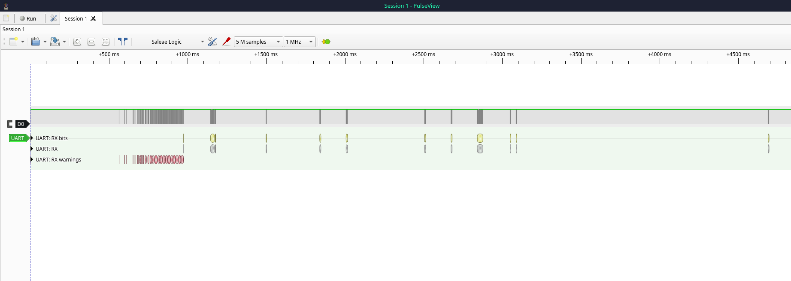

# TP-Link TL-WR841N Router (v9.2)


This is a write-up of my first hardware hacking project, targeting the TP-Link TL-WR841N (v9.2). I chose this router specifically because of the surplus of documentation on it and figured it would make a great first hardware hacking project. Let's get started!

### Tools Used:
Digital Multimeter
Soldering Kit
HiLetGo 24MHz 8-Channel USB Logic Analyzer
DSD TECH SH-U09C5 USB to UART
## Software Used

PulseView / sigrok

## Getting Inside

I started by unscrewing the bottom two screws hidden behind the rubber feet. The bottom part of the housing is also secured by clips. I found it easiest to force my way inside near the Ethernet ports on the back of the router.

## Inside The Router

With the board out, I can see the major components and what else I'm working with. After doing a bit of digging, I identified everything:

Main Chip: **Qualcomm Atheros QCA9533**
SDRAM: **Zentel A3S56D40GTP-50L** (32MB)
SPI Flash: **Macronix (MXIC) MX25L3206E** (4MB)

There's an unpopulated UART debugging interface at J3. There's no pin labels on the silkscreen like older versions of this router, so I'll solder on pin headers to make measuring via multimeter more convenient.

My measurements suggest that the pins from left-to-right are VCC, GND, RX, and TX. 
The VCC supplies a constant 3.3V. 
Second pin tested as ground through continuity. 
Third pin read a steady 0V. A floating pin with no internal pull-up usually wanders a bit, so a clean 0V suggests a pull-down resistor
The final pin I measured it at 2.6V, normal reading during boot for TX transmitting at 115200 baud.

The TL-WR841N is incredibly well documented at 115200 baud, but for certainty (and fun), I'll hook up a logic analyzer to TX and take a look with PulseView.

*(Note: In PulseView, I left the decoder channel label set to its default RX name, though it is probing the router's TX pin)*



Okay... the beginning of this view explains the 2.6V reading from the multimeter. Looks like the TX line idles at high 3.3V and fires bursts of 0V pulses as the bootloader gets started. The multimeter averages the two out. Let's try to calculate baud rate now by zooming in a bit.


Using PulseView's timing cursors across the start bit measures a bit width of $9\, \mu\text{s}$. A true 115200 baud bit takes $8.68 \, \mu\text{s}$: 

$$\frac{1}{115200} \approx 8.68 \times 10^{-6}\text{ s}$$


However, a 1MHz clock can only read in whole $1\,\mu\text{s}$ steps, so the start bit spanned 9 sample dots (or $\approx 111.1\text{ kHz}$). 

With the baud rate confirmed, I set PulseView's UART decoder to ASCII mode and I exported the decoder annotations, resampling at 2 MHz (where the start bit now spans 17 samples):

```text
4537-4554 UART: RX: Start bit
4554-4693 UART: RX: [01]
4693-4710 UART: RX: Stop bit
4706-4723 UART: RX: Start bit
4723-4862 UART: RX: [D4]
4862-4879 UART: RX: Stop bit
...
2281446-2281463 UART: RX: Start bit
2281463-2281602 UART: RX: [0A]
2281602-2281619 UART: RX: Stop bit
2281613-2281630 UART: RX: Start bit
2281630-2281769 UART: RX: U
2281769-2281786 UART: RX: Stop bit
```

(These are just 12 lines from a sample that had 3702... you can [view the full sample here](UART.txt))

The first few bytes (`[01]`, `[D4]`) are garbage as the board powers up. Real text starts later at around 1.14 seconds (`sample 2281630`), starting with `U`.

To strip out the `Start bit`/`Stop bit` lines and sample timestamps, I ran this single line in my Linux terminal:

```bash
grep -vE "Start bit|Stop bit" UART.txt | sed 's/.*UART: RX: //' | tr -d '\n' | sed 's/\[0D\]\[0A\]/\n/g; s/\[09\]/\t/g'
```

Quick overview of the commands I used to parse:

`grep -vE`: tells grep to exclude lines that match `Start bit` or `Stop bit` , and `-E` enables extended expressions so pipe (`|`) acts as an OR

`sed`: stream editor, used twice. First to strip the sample timestamps and prefix off every line, and, second to convert the literal carriage-return, line-feed (`[0D][0A]`) and tab ( `[09]`) tags into actual newlines and tabs

`tr -d`: delete original newline `'\n'`, so the characters collapse into one continuous text stream before the line breaks are formatted

This reconstructs the router's initial boot log directly from the UART capture:

```text
U-Boot 1.1.4 (Build from LSDK-9.5.3.16 at Oct 13 2014 - 17:01:20)  
  
ap143 - Honey Bee 1.1  
  
DRAM:   32 MB  
Flash Manuf Id 0xc2, DeviceId0 0x20, DeviceId1 0x16  
Flash:  4 MB  
Using default environment  
  
In:    serial  
Out:   serial  
Err:   serial  
Net:   ath_gmac_enet_initialize...  
ath_gmac_enet_initialize: reset mask:0xc02200  
Scorpion ---->S27 PHY*  
S27 reg init  
GMAC: cfg1 0x800c0000 cfg2 0x7114  
eth0: ba:be:fa:ce:08:41  
athrs27_phy_setup ATHR_PHY_CONTROL 4:0x1000  
athrs27_phy_setup ATHR_PHY_SPEC_STAUS 4:0x10  
eth0 up  
Honey Bee ---->  MAC 1 S27 PHY*  
S27 reg init  
ATHRS27: resetting s27  
ATHRS27: s27 reset done  
GMAC: cfg1 0x800c0000 cfg2 0x7214  
eth1: ba:be:fa:ce:08:41  
athrs27_phy_setup ATHR_PHY_CONTROL 0:0x1000  
athrs27_phy_setup ATHR_PHY_SPEC_STAUS 0:0x10  
athrs27_phy_setup ATHR_PHY_CONTROL 1:0x1000  
athrs27_phy_setup ATHR_PHY_SPEC_STAUS 1:0x10  
athrs27_phy_setup ATHR_PHY_CONTROL 2:0x1000  
athrs27_phy_setup ATHR_PHY_SPEC_STAUS 2:0x10  
athrs27_phy_setup ATHR_PHY_CONTROL 3:0x1000  
athrs27_phy_setup ATHR_PHY_SPEC_STAUS 3:0x10  
eth1 up  
eth0, eth1  
Setting 0x181162c0 to 0x58b1a100  
is_auto_upload_firmware=0  
Autobooting in 1 seconds  
## Booting image at 9f020000 ...  
  Uncompressing Kernel Image ...
```

From this capture, I learn several key things before even opening a serial terminal:

* The router runs U-Boot 1.1.4, and `ap143` ("Honey Bee") identifies the Qualcomm Atheros reference board and QCA9533 chip family
* U-Boot reports `DRAM: 32 MB` and `Flash: 4 MB`, which corresponds to the hardware I identified earlier (`0xc2` is Macronix's manufacturer code)
* U-Boot gives a 1-second interruption window (`Autobooting in 1 seconds`) before booting the Linux kernel located at memory address **`0x9f020000`**
* The Atheros misspells `STATUS` as `STAUS` per its source code (lol)

### Current Status & Next Steps
* **Next up:** Hook up the USB-to-UART adapter to verify the `RX` pin with live keystrokes, explore the root shell, map the flash partitions, and dump the firmware.

### References & Inspiration
* [OpenWrt TP-Link TL-WR841N Wiki](https://openwrt.org/toh/tp-link/tl-wr841nd)
* VoidStar Security Hardware Hacking Roadmap
* Past WR841N hardware research by Zero Day Initiative (ZDI) & write-ups I found by adamhlt and JulianOzelRose