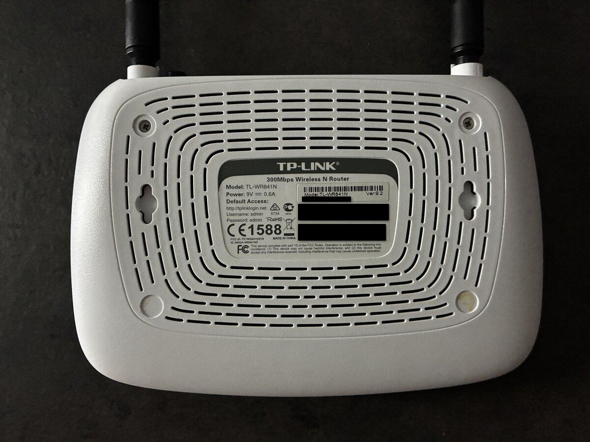
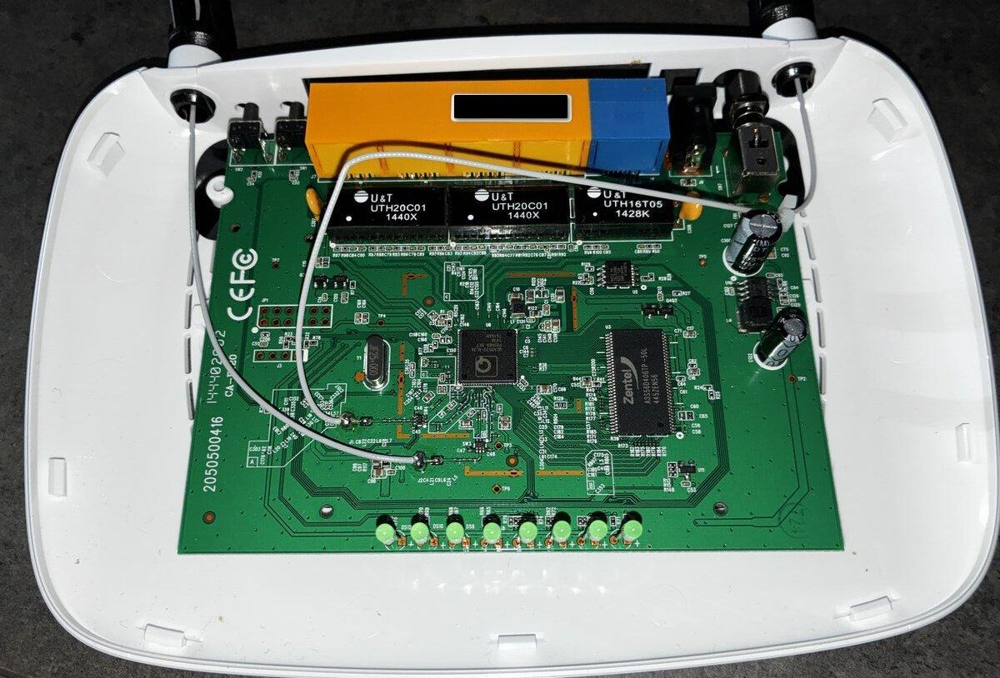
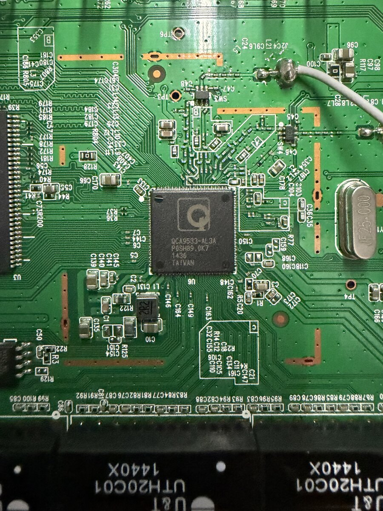
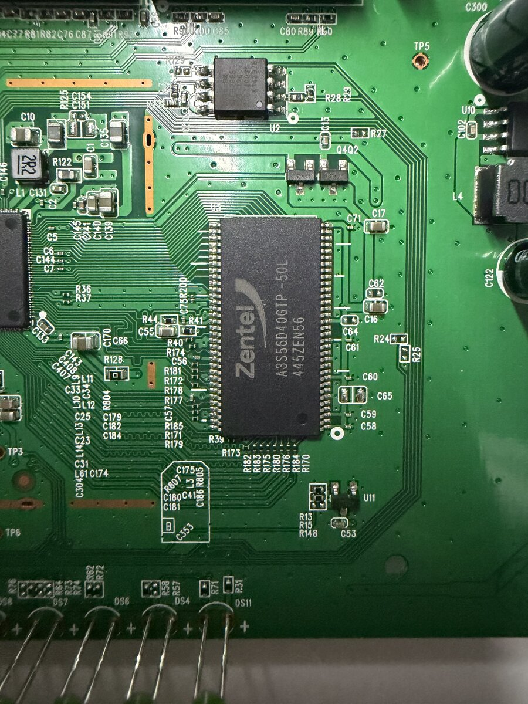
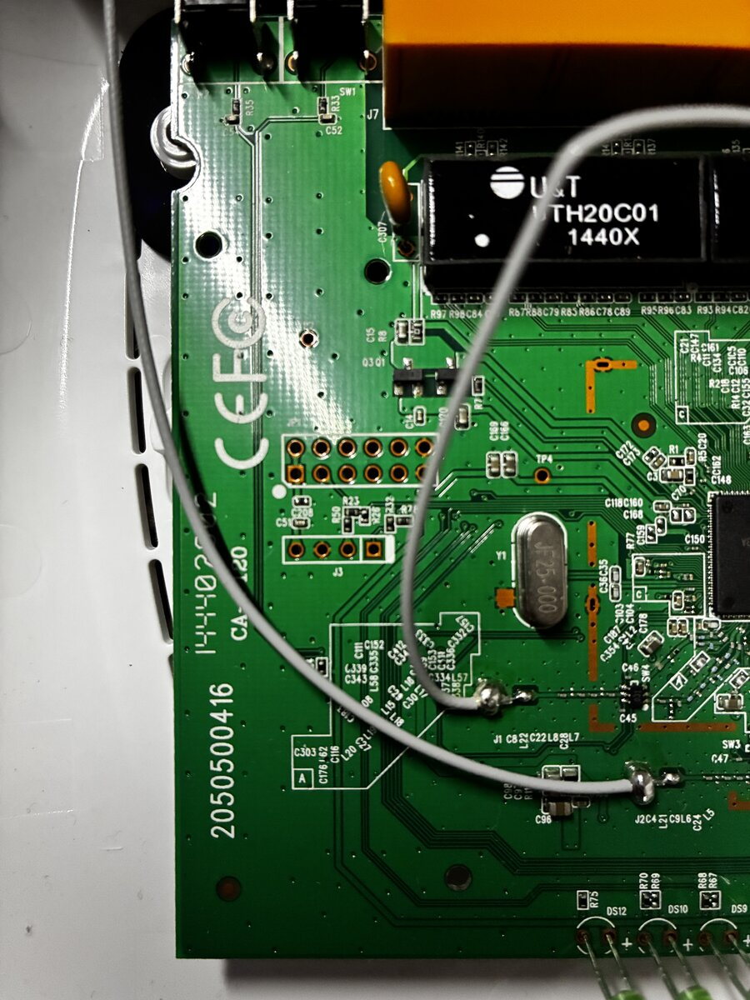
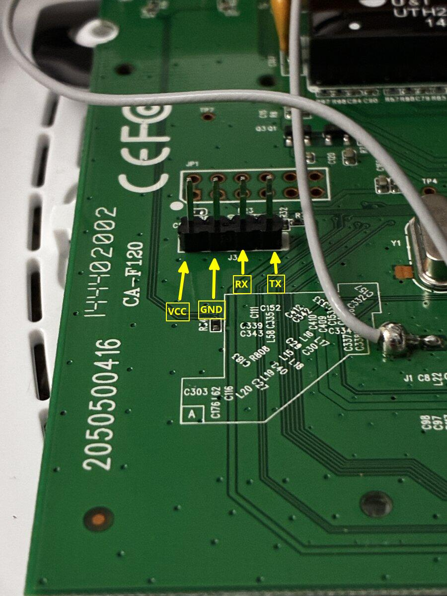
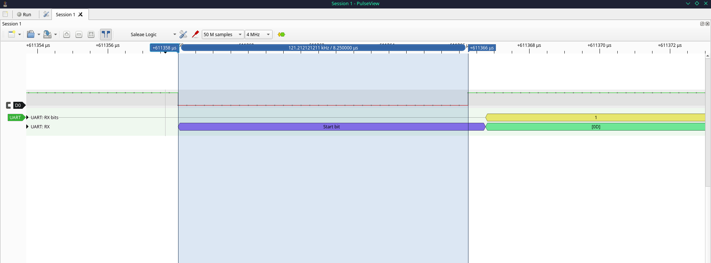

# TP-Link TL-WR841N Router (v9.2)


This is a write-up of my first hardware hacking project, targeting the TP-Link TL-WR841N (v9.2). I chose this router specifically because of the surplus of documentation on it and figured it would make a great first hardware hacking project.

My goals for this project: 
1) Identify the hardware and locate the debug interface 
2) Capture and read the boot log over UART 
3) Get a root shell
4) Dump the SPI flash and analyze the firmware
### Tools Used:
* Digital Multimeter
* Soldering Kit
* HiLetGo 24MHz 8-Channel USB Logic Analyzer
* DSD TECH SH-U09C5 USB to UART

### Software Used:
* PulseView / sigrok

## Getting Inside

|  |  |
| :------------------------------------: | :------------------------------------------: |

*Top and bottom view of housing*

I started by unscrewing the bottom two screws hidden behind the rubber feet. The bottom part of the housing is also secured by clips. I found it easiest to force my way inside near the Ethernet ports on the back of the router.

## Inside The Router

<p align="center">
  
</p>

With the board out, I can see the major components and what else I'm working with. After doing a bit of digging, I identified everything:

* Main Chip: **Qualcomm Atheros QCA9533**
* SDRAM: **Zentel A3S56D40GTP-50L** (32MB)
* SPI Flash: **Macronix (MXIC) MX25L3206E** (4MB)

|  |  |
| :---------------------------------------: | :--------------------------------: |

*Closeups of main chip and SDRAM*

There's an unpopulated UART debugging interface at J3. There are no pin labels on the silkscreen like older versions of this router, so I'll solder on pin headers to make measuring via multimeter more convenient.

|  |  |
| :----------------------------------: | :--------------------------------------: |

*UART port at J3, pre and post surgery*

My measurements suggest that the pins from left-to-right are VCC, GND, RX, and TX:
* VCC supplies a constant 3.3V
* GND through continuity
* RX: steady 0V. A floating pin usually wanders, so a clean 0V suggests a pull-down resistor
* TX: 2.6V average on boot (I explain below)

The TL-WR841N is incredibly well documented at 115,200 baud, but for certainty (and fun), I'll hook up a logic analyzer to TX and take a look with PulseView.

## Pulseview

*(Note: In PulseView, I left the decoder channel label set to its default RX name, but it is probing the router's TX pin)*


Looks like the line idles high at 3.3 V and sends bursts of 0 V pulses during boot, which is consistent with the 2.6 V average my multimeter showed me.

And the console decodes cleanly at 115,200. To check the rate, I measured the start-bit width with the cursors and the spacing between back-to-back frames at 1, 2 and 4 MHz capture rates. The 4 MHz results (8.25 µs start bit) suggest an actual rate of around 120,000 baud, about 4% faster than normal. I haven’t determined whether that comes from the chip's clock or my analyzer’s clock. Regardless, the UART receiver tolerates this much error and still decodes.




I set PulseView's UART decoder to ASCII mode and I exported the decoder annotations from the **2MHz** capture:

```text
4537-4554 UART: RX: Start bit
4554-4693 UART: RX: [01]
4693-4710 UART: RX: Stop bit
4706-4723 UART: RX: Start bit
4723-4862 UART: RX: [D4]
4862-4879 UART: RX: Stop bit
...
2281446-2281463 UART: RX: Start bit
2281463-2281602 UART: RX: [0A]
2281602-2281619 UART: RX: Stop bit
2281613-2281630 UART: RX: Start bit
2281630-2281769 UART: RX: U
2281769-2281786 UART: RX: Stop bit
```

*(These are just 12 lines from a sample that had 3702 total lines- you can [see the full sample here](UART.txt))*

The first few bytes (`[01]`, `[D4]`) are probably just noise as the board powers up. Then follows a few more garbage bytes and a double carriage-return + line-feed (`[0D] [0A]`), before actual text appears, at around 1.14 seconds (`sample 2281630`), starting with the first `U` of `U-Boot`.

To strip out the `Start bit`/`Stop bit` lines and sample timestamps, I ran this single line in my Linux terminal:

```bash
grep -vE "Start bit|Stop bit" UART.txt | sed 's/.*UART: RX: //' | tr -d '\n' | sed 's/\[0D\]\[0A\]/\n/g; s/\[09\]/\t/g'
```

Quick overview of the commands I used to parse:

`grep -vE`: tells grep to exclude lines that match `Start bit` or `Stop bit` , and `-E` enables extended expressions so pipe (`|`) acts as an OR

`sed`: stream editor, used twice. First to strip the sample timestamps and prefix off every line, and, second to convert the literal carriage-return, line-feed (`[0D][0A]`) and tab ( `[09]`) tags into actual newlines and tabs

`tr -d`: delete original newline `'\n'`, so the characters collapse into one continuous text stream before the line breaks are formatted

This reconstructs the router's initial boot log directly from the UART capture:

```text
U-Boot 1.1.4 (Build from LSDK-9.5.3.16 at Oct 13 2014 - 17:01:20)  
  
ap143 - Honey Bee 1.1  
  
DRAM:   32 MB  
Flash Manuf Id 0xc2, DeviceId0 0x20, DeviceId1 0x16  
Flash:  4 MB  
Using default environment  
  
In:    serial  
Out:   serial  
Err:   serial  
Net:   ath_gmac_enet_initialize...  
ath_gmac_enet_initialize: reset mask:0xc02200  
Scorpion ---->S27 PHY*  
S27 reg init  
GMAC: cfg1 0x800c0000 cfg2 0x7114  
eth0: ba:be:fa:ce:08:41  
athrs27_phy_setup ATHR_PHY_CONTROL 4:0x1000  
athrs27_phy_setup ATHR_PHY_SPEC_STAUS 4:0x10  
eth0 up  
Honey Bee ---->  MAC 1 S27 PHY*  
S27 reg init  
ATHRS27: resetting s27  
ATHRS27: s27 reset done  
GMAC: cfg1 0x800c0000 cfg2 0x7214  
eth1: ba:be:fa:ce:08:41  
athrs27_phy_setup ATHR_PHY_CONTROL 0:0x1000  
athrs27_phy_setup ATHR_PHY_SPEC_STAUS 0:0x10  
athrs27_phy_setup ATHR_PHY_CONTROL 1:0x1000  
athrs27_phy_setup ATHR_PHY_SPEC_STAUS 1:0x10  
athrs27_phy_setup ATHR_PHY_CONTROL 2:0x1000  
athrs27_phy_setup ATHR_PHY_SPEC_STAUS 2:0x10  
athrs27_phy_setup ATHR_PHY_CONTROL 3:0x1000  
athrs27_phy_setup ATHR_PHY_SPEC_STAUS 3:0x10  
eth1 up  
eth0, eth1  
Setting 0x181162c0 to 0x58b1a100  
is_auto_upload_firmware=0  
Autobooting in 1 seconds  
## Booting image at 9f020000 ...  
  Uncompressing Kernel Image ...
```

From this capture, I learn several key things before even opening a serial terminal:

* The router runs U-Boot 1.1.4, and `ap143` is the Qualcomm Atheros reference board and "Honey Bee" is the codename for the chip family
* U-Boot reports `DRAM: 32 MB` and `Flash: 4 MB`, which corresponds to the hardware I identified earlier (`0xc2` is Macronix's manufacturer code)
* U-Boot suggests a 1-second interruption window (`Autobooting in 1 seconds`) before booting the Linux kernel image located at flash address **`0x9f020000`**
* The Atheros misspells `STATUS` as `STAUS` (lol)

### Current Status & Next Steps
* Goals 1 and 2 are done, working on 3 (gaining root shell)

### References & Inspiration
* [OpenWrt TP-Link TL-WR841N Wiki](https://openwrt.org/toh/tp-link/tl-wr841nd)
* [VoidStar Security Hardware Hacking Roadmap](https://voidstarsec.com/roadmap/)
* Past WR841N hardware research by [Zero Day Initiative (ZDI)](https://www.zerodayinitiative.com/blog/2019/9/2/mindshare-hardware-reversing-with-the-tp-link-tl-wr841n-router) & excellent write-ups by [adamhlt](https://github.com/adamhlt/TL-WR841N) and [JulianOzelRose](https://github.com/JulianOzelRose/TL-WR841N-v14)